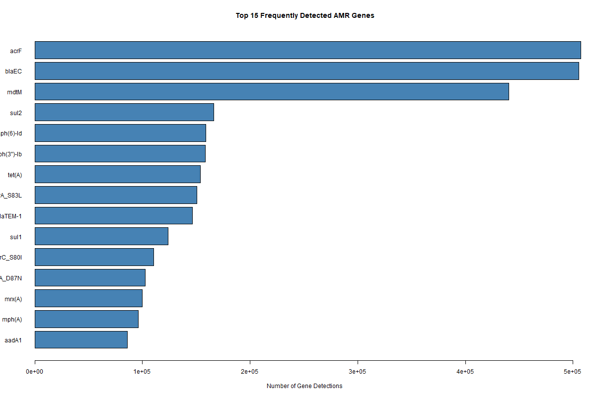
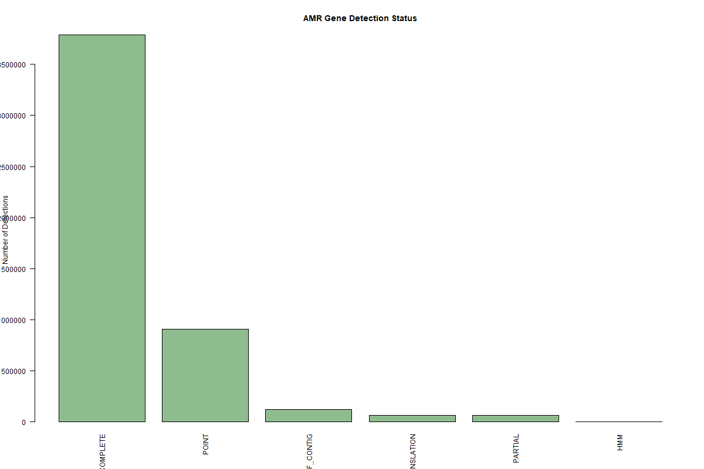
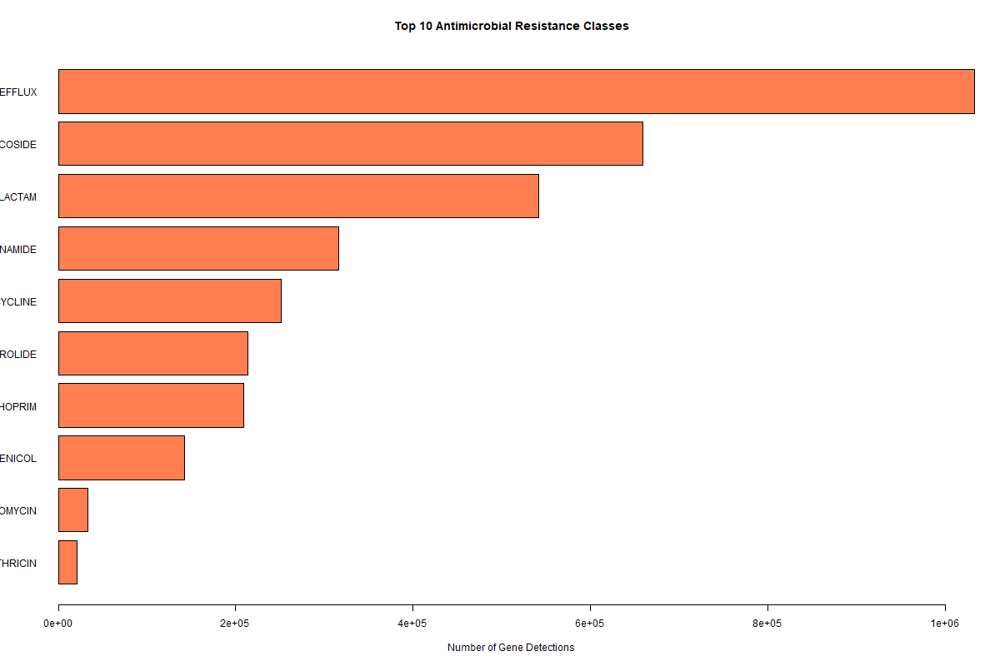
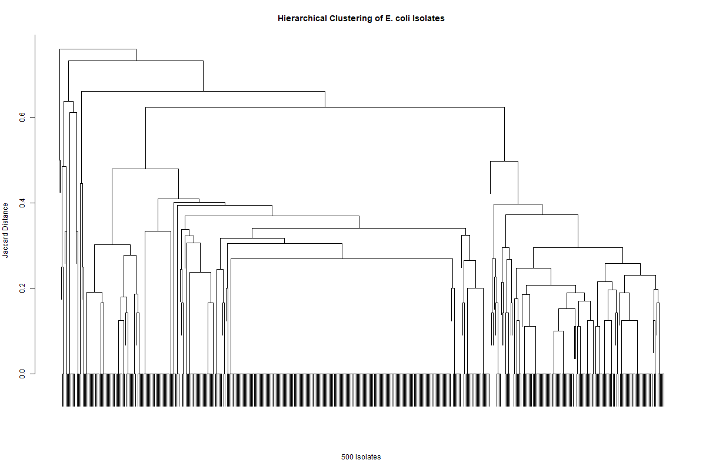
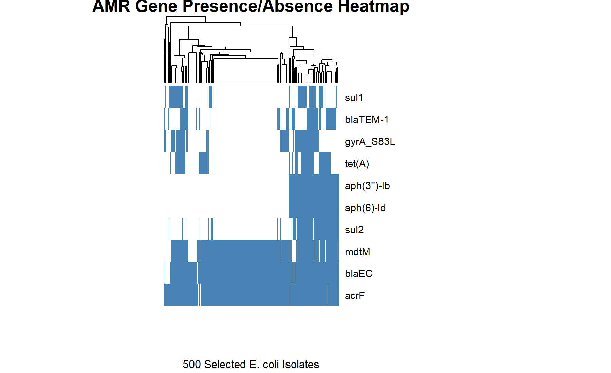

# Analysis of Antimicrobial Resistance Genotypes in *Escherichia coli* Using Bioinformatics Data

## 1. Abstract

Antimicrobial resistance (AMR) is a major global health concern because it reduces the effectiveness of medicines used to treat bacterial infections. *Escherichia coli* (*E. coli*) is a common bacterium that can cause infections in humans and animals. Studying its antimicrobial resistance genes helps researchers understand genetic patterns associated with resistance.

This project analyses publicly available *E. coli* genomic surveillance data obtained from the National Center for Biotechnology Information (NCBI) Pathogen Detection database. The main objectives are to identify frequently detected AMR genes, examine their detection statuses, classify genes using the NCBI reference gene catalogue, and explore similarities between isolates through hierarchical clustering.

The final cleaned dataset contains 523,970 records and 17 columns. Data cleaning, exploratory data analysis, gene frequency analysis, and hierarchical clustering were performed using R. The three most frequently detected genes were `acrF`, `blaEC`, and `mdtM`. EFFLUX, AMINOGLYCOSIDE, and BETA-LACTAM were the highest-frequency antimicrobial class categories.

Hierarchical clustering was performed on 500 randomly selected isolates using the ten most frequently detected genes. Three clusters were identified, containing 483, 15, and 2 isolates.

The results provide an exploratory overview of AMR genotype patterns. Gene detection should not be interpreted as direct evidence of clinical or phenotypic antibiotic resistance.

## 2. Introduction

Antimicrobial resistance occurs when microorganisms develop the ability to survive exposure to antimicrobial medicines. It is an important public health challenge because resistant infections can become more difficult to treat.

*E. coli* is commonly found in the intestinal tract of humans and animals. Some strains can cause infections and may carry genes associated with antimicrobial resistance.

Bioinformatics provides computational methods for analysing biological information. By analysing AMR genotype data, researchers can identify commonly detected genes and explore patterns among bacterial isolates.

### Aim

To analyse antimicrobial resistance genotype patterns in *Escherichia coli* using publicly available biological data and bioinformatics methods.

### Objectives

- Obtain publicly available *E. coli* antimicrobial resistance data.
- Import and clean the biological dataset using R.
- Examine missing values, duplicate records, and data-quality problems.
- Calculate the frequency of detected AMR genes.
- Analyse AMR gene detection statuses.
- Classify detected genes using the NCBI reference gene catalogue.
- Apply hierarchical clustering to explore similarities between selected isolates.
- Visualise and interpret the results.

## 3. Dataset Description

### 3.1 Data Sources

The main dataset was obtained from the NCBI Pathogen Detection Isolates Browser.

The NCBI search was filtered using the species taxonomy identifier **562**, which represents *Escherichia coli*. The browser uses the broader organism group label "E.coli and Shigella"; therefore, the taxonomy filter was used as the selection criterion.

The second dataset was the NCBI AMRFinderPlus Reference Gene Catalogue. It was used to associate detected gene families with antimicrobial resistance classifications.

### 3.2 Dataset Overview

The final cleaned dataset contains:

| Description | Value |
|---|---:|
| Total records | 523,970 |
| Total columns | 17 |
| Unique values in the Isolate column | 523,919 |
| Records with AMR genotype information | 523,935 |
| Missing AMR genotype values | 35 |
| Completely duplicated records | 0 |

Important columns include `Strain`, `Isolate`, `Location`, `Isolation.source`, `BioSample`, `Assembly`, `AMR.genotypes`, and `Computed.types`.

The reference gene catalogue contains 11,554 rows and 25 columns. The `gene_family`, `class`, `subclass`, and `product_name` fields were used for gene classification.

### 3.3 Data Quality and Cleaning

The original CSV contained parsing problems, including inconsistent formatting and extra fields. The NCBI-filtered export initially contained 523,982 rows. Twelve malformed records could not be reliably aligned with the expected columns and were excluded.

During cleaning, 220 records contained assembly or sample identifiers in the AMR genotype column. Genotype information was recovered from the `Computed.types` column for 212 records. Eight unresolved records were treated as missing genotype information.

After cleaning, 35 records had missing AMR genotype values when empty and whitespace-only values were included. No completely duplicated records remained.

Ten BioSample accessions were checked against biological sample records, and all ten were confirmed as *E. coli*. This was a sample-based verification, not an individual verification of every record.

## 4. Methodology

The project was developed using R and RStudio. The analysis was organised into five scripts.

### 4.1 Data Import and Cleaning

The datasets were imported and their dimensions, structures, and columns were examined. Missing values and duplicate records were checked. Incorrect identifiers in the AMR genotype column were investigated and corrected where possible.

The cleaned dataset was saved in RDS format for subsequent analysis.

### 4.2 Exploratory Data Analysis

Exploratory Data Analysis (EDA) was performed to understand the dataset. The analysis included:

- Dataset dimensions and column structures.
- Missing-value counts.
- Duplicate-record checks.
- Unique isolate counts.
- Records containing AMR genotype information.

### 4.3 AMR Gene Frequency Analysis

AMR genotype strings contain multiple gene entries separated by commas. The entries were separated, and gene names were extracted from valid genotype records containing an equals sign.

The frequency of each gene was calculated. The 15 most frequently detected genes were presented in a bar chart.

### 4.4 Detection Status Analysis

Detection statuses were extracted from genotype entries. The analysed categories were:

- COMPLETE
- POINT
- PARTIAL_END_OF_CONTIG
- MISTRANSLATION
- PARTIAL
- HMM

The frequency of each status was calculated and visualised.

### 4.5 Antimicrobial Class Classification

Detected gene families were matched with the NCBI AMRFinderPlus Reference Gene Catalogue using the `gene_family` field.

The associated antimicrobial classes were extracted, and gene detection frequencies were aggregated by class. Some gene families can have multiple catalogue classifications, so class totals may overlap.

### 4.6 Hierarchical Clustering

Hierarchical clustering was performed using a random sample of 500 isolates and the ten most frequently detected AMR genes.

The following procedure was used:

1. Select 500 isolates using `set.seed(123)`.
2. Create a binary gene presence/absence matrix.
3. Calculate Jaccard distances using the `vegdist()` function from the `vegan` package.
4. Apply hierarchical clustering using average linkage.
5. Divide the isolates into three clusters using `cutree()`.
6. Calculate and visualise the gene profiles of each cluster.

## 5. Results

### 5.1 Dataset Quality

The cleaned dataset contained 523,970 records. There were 523,935 records with AMR genotype information and 35 records with missing genotype values. No completely duplicated records were found.

Some metadata columns contained substantial missing information, particularly `Food.origin`, `Serovar`, and `Min.diff`. These missing values should be considered when interpreting the dataset.

### 5.2 Top 15 AMR Genes

The 15 most frequently detected genes were:

| Gene | Frequency |
|---|---:|
| acrF | 507,330 |
| blaEC | 505,173 |
| mdtM | 440,146 |
| sul2 | 166,269 |
| aph(6)-Id | 159,072 |
| aph(3'')-Ib | 158,278 |
| tet(A) | 153,679 |
| gyrA_S83L | 150,529 |
| blaTEM-1 | 146,521 |
| sul1 | 123,790 |
| parC_S80I | 110,347 |
| gyrA_D87N | 102,654 |
| mrx(A) | 99,835 |
| mph(A) | 96,137 |
| aadA1 | 85,899 |

The most frequently detected genes were `acrF`, `blaEC`, and `mdtM`.



### 5.3 AMR Detection Status

| Detection Status | Frequency |
|---|---:|
| COMPLETE | 3,791,134 |
| POINT | 907,271 |
| PARTIAL_END_OF_CONTIG | 121,801 |
| MISTRANSLATION | 65,925 |
| PARTIAL | 65,442 |
| HMM | 3,369 |

COMPLETE was the most frequently observed detection status, followed by POINT. These values represent genotype-entry detections, not the number of isolates.



### 5.4 Antimicrobial Class Analysis

The ten highest-frequency antimicrobial class categories were:

| Antimicrobial Class | Frequency |
|---|---:|
| EFFLUX | 1,032,852 |
| AMINOGLYCOSIDE | 658,862 |
| BETA-LACTAM | 541,431 |
| SULFONAMIDE | 315,966 |
| TETRACYCLINE | 251,313 |
| MACROLIDE | 213,455 |
| TRIMETHOPRIM | 209,251 |
| PHENICOL | 142,135 |
| BLEOMYCIN | 33,424 |
| STREPTOTHRICIN | 21,198 |

EFFLUX had the highest aggregated frequency, followed by AMINOGLYCOSIDE and BETA-LACTAM. Class totals are not mutually exclusive because some gene families have multiple catalogue classifications.



### 5.5 Hierarchical Clustering

The clustering analysis used 500 randomly selected isolates and the ten most frequently detected genes.

The clustering produced three groups:

| Cluster | Number of isolates | Percentage |
|---|---:|---:|
| Cluster 1 | 483 | 96.6% |
| Cluster 2 | 15 | 3.0% |
| Cluster 3 | 2 | 0.4% |
| **Total** | **500** | **100%** |

Cluster 1 contained most of the sampled isolates. It showed high average presence of `acrF`, `blaEC`, and `mdtM`.

Cluster 2 contained 15 isolates. All had `acrF` detected, while approximately 13.3% had `blaEC` detected.

Cluster 3 contained only two isolates. Both had `blaEC` detected, while neither had `acrF` or `mdtM`.

The clusters were highly imbalanced. Therefore, these results should be interpreted as exploratory patterns rather than three equally sized biological groups.

**Hierarchical clustering dendrogram**



**AMR gene presence/absence heatmap**



## 6. Discussion

The analysis identified `acrF`, `blaEC`, and `mdtM` as the most frequently detected AMR genes in the available dataset. The detection-status analysis showed that COMPLETE was the most frequent status.

The antimicrobial class analysis identified EFFLUX, AMINOGLYCOSIDE, and BETA-LACTAM as the highest-frequency categories. These findings reflect the classifications in the NCBI reference catalogue.

Hierarchical clustering placed most sampled isolates in Cluster 1. The other two clusters were much smaller, indicating that the selected genes produced a dominant pattern among the sampled records, with a smaller number of different gene combinations.

There are several limitations. The clustering used only 500 randomly selected isolates and ten frequently detected genes. The choice of three clusters was a methodological decision, and the very small cluster sizes require cautious interpretation.

The analysis also relies on genotype information rather than laboratory antimicrobial susceptibility testing. The presence of a resistance-associated gene does not automatically prove that an isolate is phenotypically resistant to a particular antibiotic.

Future work could include cluster validation, analysis of a larger sample, comparisons across collection dates and locations, and integration with laboratory susceptibility results where available.

## 7. Conclusion

This project demonstrated how publicly available biological data can be analysed using R to investigate AMR genotype patterns in *Escherichia coli*.

The workflow included data import, cleaning, exploratory analysis, gene frequency analysis, detection-status analysis, reference-based gene classification, and hierarchical clustering.

The most frequently detected genes were `acrF`, `blaEC`, and `mdtM`. The highest-frequency antimicrobial class categories were EFFLUX, AMINOGLYCOSIDE, and BETA-LACTAM. Clustering of 500 sampled isolates produced three groups, with 96.6% belonging to Cluster 1.

The findings provide an exploratory view of AMR genotype patterns and demonstrate the importance of data cleaning and careful interpretation in bioinformatics.

## 8. Reproducibility

### Software and Packages

- R
- RStudio
- `readr`
- `vegan`

Install the required packages in R using:

```r
install.packages(c("readr", "vegan"))
```

### Project Structure

```text
Ecoli_AMR_Research/
│
├── code/
│   ├── 01_data_import.R
│   ├── 02_data_cleaning.R
│   ├── 03_exploratory_analysis.R
│   ├── 04_amr_gene_analysis.R
│   └── 05_clustering_analysis.R
│
├── data/
│   ├── ecoli_clean.rds
│   └── ReferenceGeneCatalog.txt
│
├── report/
│   ├── analysis_report.Rmd
│   └── analysis_report.html
│
├── results/
│   ├── missing_values_summary.csv
│   ├── dataset_summary.txt
│   ├── amr_gene_frequencies.csv
│   ├── amr_detection_status.csv
│   ├── antimicrobial_class_frequencies.csv
│   ├── gene_classification.csv
│   ├── gene_presence_absence_matrix.csv
│   ├── isolate_clusters.csv
│   ├── cluster_gene_profile.csv
│   ├── top_15_amr_genes.png
│   ├── amr_detection_status.png
│   ├── top_10_antimicrobial_classes.png
│   ├── hierarchical_clustering.png
│   └── amr_cluster_heatmap.png
│
├── Ecoli_AMR_Research.Rproj
└── README.md
```

### Dataset Download Instructions

The original main CSV is large and is not included in this GitHub repository.

To obtain the main dataset:

1. Open the NCBI Pathogen Detection Isolates Browser.
2. Search using the species taxonomy filter `species_taxid:562`.
3. Export the filtered isolate data as a CSV file.
4. Save the downloaded file in the project's `data/` folder.
5. Obtain the NCBI AMRFinderPlus Reference Gene Catalogue and save it as `ReferenceGeneCatalog.txt` in the same folder.

The cleaned dataset `ecoli_clean.rds` is included in the project data folder to support the analysis workflow without requiring the large original CSV.

### Running the Analysis

1. Download or clone this GitHub repository.
2. Open `Ecoli_AMR_Research.Rproj` in RStudio.
3. Install the required R packages.
4. Check that the required data files are in the `data/` folder.
5. Run the R scripts in numerical order.
6. View the generated tables and figures in the `results/` folder.
7. Open `report/analysis_report.html` to read the rendered report.

The clustering script uses `set.seed(123)` to make the random sampling reproducible.

## 9. References

1. National Center for Biotechnology Information (NCBI). *Pathogen Detection Isolates Browser*.
2. National Center for Biotechnology Information (NCBI). *AMRFinderPlus Reference Gene Catalogue and documentation*.
3. R Core Team. *R: A Language and Environment for Statistical Computing*. R Foundation for Statistical Computing.
4. Oksanen, J. et al. *vegan: Community Ecology Package*.
5. Wickham, H. et al. *readr: Read Rectangular Text Data*.