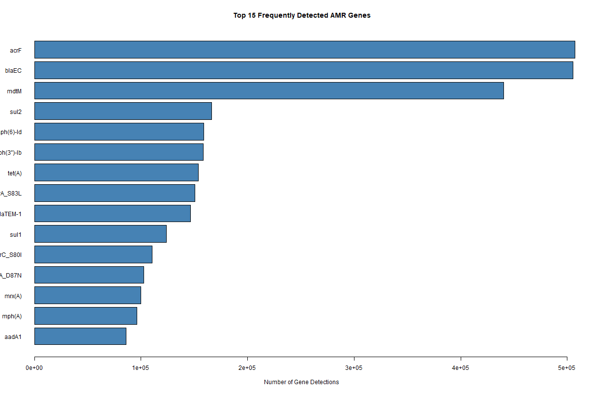
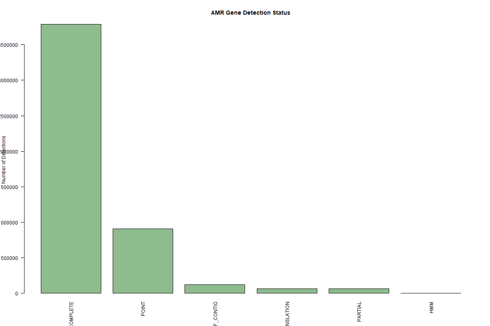
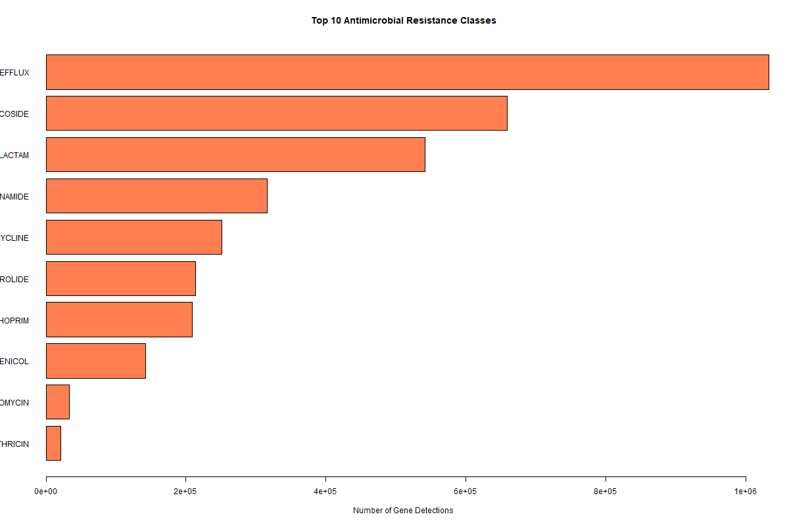
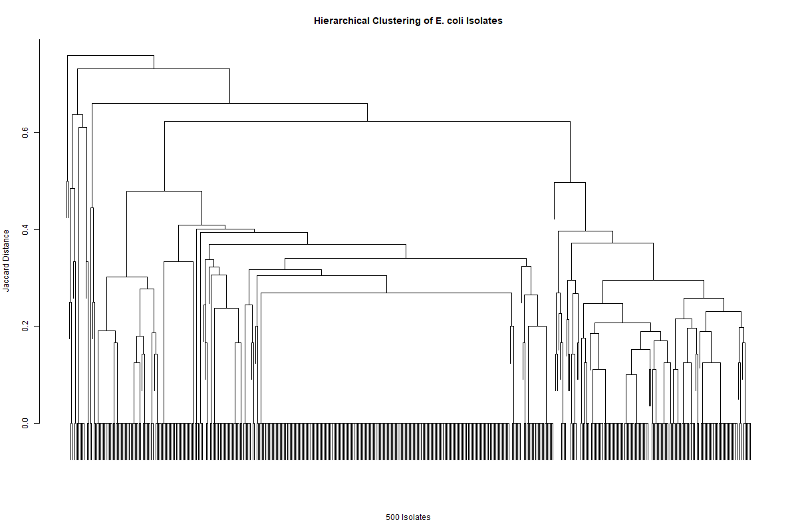
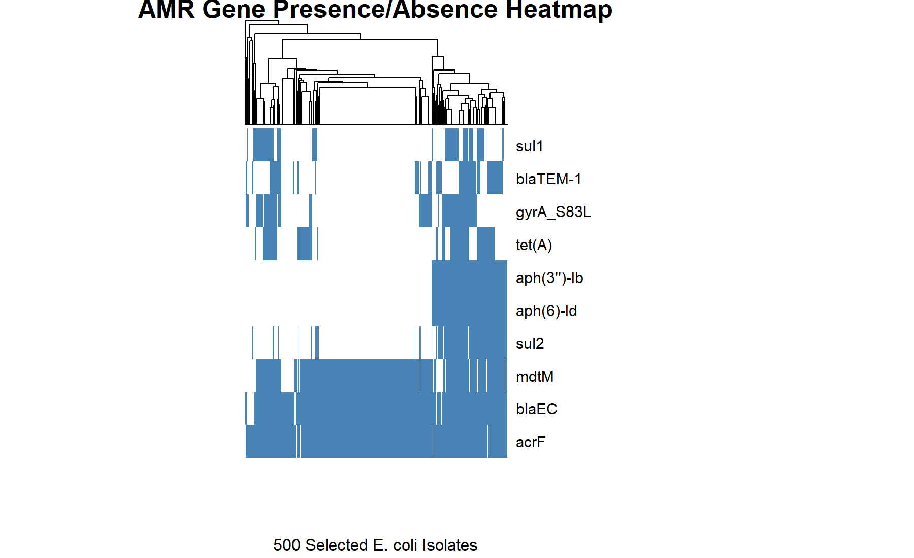

```{r setup, include=FALSE}
knitr::opts_chunk$set(
  echo = FALSE,
  warning = FALSE,
  message = FALSE,
  fig.align = "center"
)
```

# 1. Introduction

Antimicrobial resistance (AMR) is a major global health concern. It occurs when microorganisms develop the ability to survive exposure to antimicrobial medicines that would normally inhibit or kill them.

*Escherichia coli* (*E. coli*) is a common bacterium found in the intestinal tract of humans and animals. Some strains can cause infections and may carry antimicrobial resistance genes.

Bioinformatics provides computational methods to analyse biological data. By analysing AMR genotype information, researchers can identify frequently detected resistance-associated genes and explore patterns among bacterial isolates.

This project investigates AMR genotype patterns in *E. coli* using publicly available genomic surveillance data from the National Center for Biotechnology Information (NCBI).

# 2. Aim and Objectives

## 2.1 Aim

To analyse antimicrobial resistance genotype patterns in *Escherichia coli* using publicly available biological data and bioinformatics methods.

## 2.2 Objectives

- Obtain publicly available *E. coli* genomic surveillance data.
- Import and examine the dataset using R.
- Identify missing values, duplicate records, and data-quality problems.
- Calculate the frequency of detected AMR genes.
- Examine AMR gene detection statuses.
- Classify detected genes using the NCBI reference gene catalogue.
- Apply hierarchical clustering to explore similarities between selected isolates.
- Visualise and interpret the analysis results.

# 3. Dataset Description

## 3.1 Data Source

The primary dataset was obtained from the NCBI Pathogen Detection Isolates Browser.

The organism was selected using the NCBI search filter `species_taxid:562`, which identifies *Escherichia coli*.

A separate NCBI AMRFinderPlus Reference Gene Catalogue was used to classify detected AMR genes.

## 3.2 Dataset Overview

After filtering and removing 12 malformed records, the final dataset contained:

- Total records: 523,970
- Total columns: 17
- Unique isolate values: 523,919
- Records containing AMR genotype information: 523,935
- Missing AMR genotype values: 35

The dataset includes isolate identifiers, strain information, collection details, genomic information, and AMR genotype findings.

# 4. Data Cleaning and Quality Control

Data cleaning was performed to improve the quality and reliability of the dataset before analysis.

The following activities were completed:

- Checked missing values in all columns.
- Checked duplicate records.
- Examined the AMR genotype column for incorrectly placed identifiers.
- Recovered genotype information from the Computed types column where possible.
- Marked unresolved incorrect entries as missing.
- Saved the cleaned dataset for further analysis.

The original filtered export contained 523,982 rows. Twelve malformed records were excluded because their fields were not correctly aligned.

During further cleaning, 220 suspicious entries were identified in the AMR genotype column. Genotype information was recovered for 212 entries using the Computed types column. Eight unresolved entries were marked as missing.

The final cleaned dataset contained 523,970 records. No completely duplicated records were identified.

The AMR genotype column contained 35 missing values after whitespace-only entries were also treated as missing.

Ten BioSample accessions were checked as a sample to confirm the organism identity. All ten were identified as *E. coli*. This was a sample verification, not an individual verification of every record.

# 5. Exploratory Data Analysis

Exploratory Data Analysis (EDA) was performed to understand the dataset before the main analysis.

The analysis included:

- Examining dataset dimensions.
- Examining column structures.
- Calculating missing values.
- Checking duplicate records.
- Counting unique isolate values.
- Identifying records containing AMR genotype information.

The analysis identified substantial missing information in some metadata columns. For example, isolation source, food origin, and serovar contained many missing values.

These missing values were considered when interpreting the results.

# 6. AMR Gene Frequency Analysis

The AMR genotype column contains multiple gene entries separated by commas.

The genotype information was separated into individual entries. Gene names were extracted, and their frequencies were calculated.

The following table presents the 15 most frequently detected AMR genes.

| Gene | Frequency |
|:---|---:|
| acrF | 507330 |
| blaEC | 505173 |
| mdtM | 440146 |
| sul2 | 166269 |
| aph(6)-Id | 159072 |
| aph(3'')-Ib | 158278 |
| tet(A) | 153679 |
| gyrA_S83L | 150529 |
| blaTEM-1 | 146521 |
| sul1 | 123790 |
| parC_S80I | 110347 |
| gyrA_D87N | 102654 |
| mrx(A) | 99835 |
| mph(A) | 96137 |
| aadA1 | 85899 |

The results show that `acrF`, `blaEC`, and `mdtM` were the three most frequently detected genes.

The following figure presents the top 15 AMR genes.

```{r top-genes, out.width="100%"}

```

# 7. AMR Detection Status Analysis

AMR genotype entries contain detection-status information.

The analysis identified the following detection statuses:

| Detection Status | Frequency |
|:---|---:|
| COMPLETE | 3791134 |
| POINT | 907271 |
| PARTIAL_END_OF_CONTIG | 121801 |
| MISTRANSLATION | 65925 |
| PARTIAL | 65442 |
| HMM | 3369 |

The COMPLETE status was the most frequently recorded detection status.

These values describe the annotation status of genotype entries. They do not directly measure the clinical effectiveness of antibiotics.

The following figure shows the frequency of the different detection statuses.

```{r detection-status, out.width="100%"}

```

# 8. Antimicrobial Class Analysis

Detected gene families were matched with the NCBI AMRFinderPlus Reference Gene Catalogue.

The corresponding antimicrobial classes were retrieved, and gene detection frequencies were aggregated by class.

The three highest-frequency antimicrobial class categories were:

| Antimicrobial Class | Frequency |
|:---|---:|
| EFFLUX | 1032852 |
| AMINOGLYCOSIDE | 658862 |
| BETA-LACTAM | 541431 |
| SULFONAMIDE | 315966 |
| TETRACYCLINE | 251313 |
| MACROLIDE | 213455 |
| TRIMETHOPRIM | 209251 |
| PHENICOL | 142135 |
| BLEOMYCIN | 33424 |
| STREPTOTHRICIN | 21198 |

EFFLUX had the highest frequency, followed by AMINOGLYCOSIDE and BETA-LACTAM.

Some gene families can have multiple catalogue classifications. Therefore, class totals may overlap and should not be interpreted as mutually exclusive groups or unique resistant isolates.

The following figure presents the ten highest-frequency antimicrobial class categories.

```{r antimicrobial-classes, out.width="100%"}

```

# 9. Hierarchical Clustering Analysis

Hierarchical clustering was used to explore similarities between selected *E. coli* isolates based on AMR gene presence or absence.

## 9.1 Selected Genes

The ten most frequently detected genes were selected for clustering:

1. acrF
2. blaEC
3. mdtM
4. sul2
5. aph(6)-Id
6. aph(3'')-Ib
7. tet(A)
8. gyrA_S83L
9. blaTEM-1
10. sul1

## 9.2 Clustering Method

A random sample of 500 isolates was selected using a fixed random seed of 123.

A binary presence/absence matrix was created to represent whether each selected gene was detected in each isolate.

The Jaccard distance was calculated using the `vegdist()` function from the `vegan` package.

Average-linkage hierarchical clustering was then performed using the `hclust()` function.

The dendrogram was divided into three clusters using `cutree()` with `k = 3`.

## 9.3 Cluster Results

The clustering analysis produced the following cluster sizes:

| Cluster | Number of Isolates | Percentage |
|:---|---:|---:|
| Cluster 1 | 483 | 96.6% |
| Cluster 2 | 15 | 3.0% |
| Cluster 3 | 2 | 0.4% |
| Total | 500 | 100% |

Cluster 1 contained most of the sampled isolates. Cluster 2 and Cluster 3 contained much smaller numbers of isolates.

The following dendrogram shows the hierarchical relationships among the sampled isolates.

```{r clustering-dendrogram, out.width="100%"}

```

## 9.4 Cluster Heatmap

A heatmap was created to visualise the presence and absence patterns of the ten selected AMR genes across the three clusters.

The heatmap helps compare the gene patterns among the sampled isolates.

```{r clustering-heatmap, out.width="100%"}

```

The clustering results show that most sampled isolates shared a similar pattern based on the selected genes.

However, the cluster sizes were highly imbalanced. Therefore, the smaller clusters should be interpreted cautiously.

# 10. Discussion

The analysis identified several frequently detected AMR genes in the available *E. coli* genomic surveillance dataset.

The most frequently detected genes were `acrF`, `blaEC`, and `mdtM`. These genes were commonly represented in the genotype records.

The detection-status analysis showed that COMPLETE was the most frequently recorded status. This describes the annotation status of detected genotype entries.

The antimicrobial class analysis identified EFFLUX, AMINOGLYCOSIDE, and BETA-LACTAM as the three highest-frequency categories. These findings reflect the classifications in the NCBI reference catalogue.

Hierarchical clustering showed that most of the sampled isolates belonged to Cluster 1. The other two clusters were much smaller.

The clustering analysis was exploratory. It used only 500 randomly selected isolates and ten frequently detected genes. The selection of three clusters was a methodological choice.

Overall, the findings provide an overview of AMR genotype patterns in the available dataset. They should not be interpreted as direct measurements of phenotypic antimicrobial resistance.

# 11. Limitations

This project has several limitations:

- Some dataset columns contained substantial missing information.
- The original CSV export contained malformed records.
- Some genotype entries required correction during data cleaning.
- Only ten frequently detected genes were used for clustering.
- The clustering analysis used a random sample of 500 isolates rather than the entire dataset.
- The three clusters were highly imbalanced.
- Genotype detection does not necessarily confirm phenotypic antimicrobial resistance.
- The BioSample organism verification was performed on ten selected accessions rather than every record.

Future work could include cluster validation, analysis of a larger sample, comparisons across collection dates and locations, and integration with laboratory antimicrobial susceptibility results where available.

# 12. Conclusion

This project analysed antimicrobial resistance genotype findings in *Escherichia coli* using publicly available genomic surveillance data.

The analysis included data import, cleaning, exploratory data analysis, AMR gene frequency calculation, detection-status analysis, reference-based gene classification, and hierarchical clustering.

The most frequently detected genes were `acrF`, `blaEC`, and `mdtM`. EFFLUX, AMINOGLYCOSIDE, and BETA-LACTAM were the highest-frequency antimicrobial class categories.

Hierarchical clustering of 500 sampled isolates produced three clusters. Most sampled isolates belonged to Cluster 1.

Overall, the project demonstrates how bioinformatics methods and R programming can be used to explore large biological datasets and investigate antimicrobial resistance genotype patterns.

# 13. Reproducibility

The project was developed using R and RStudio.

The project contains:

- `code/` – R scripts used for the analysis.
- `data/` – Reference gene catalogue and required data files.
- `results/` – Generated tables and figures.
- `report/` – R Markdown analysis report.

The main dataset is large and should be downloaded from its original public source rather than uploaded directly to GitHub.

The clustering analysis uses `set.seed(123)` to make the random sample reproducible.

The analysis scripts should be executed in numerical order.

# 14. References

1. National Center for Biotechnology Information (NCBI). Pathogen Detection Isolates Browser.  
   https://www.ncbi.nlm.nih.gov/pathogens/isolates/

2. National Center for Biotechnology Information (NCBI). AMRFinderPlus Database.  
   https://github.com/ncbi/amr/wiki/AMRFinderPlus-database

3. National Center for Biotechnology Information (NCBI). Pathogen Detection Help.  
   https://www.ncbi.nlm.nih.gov/pathogens/pathogens_help/